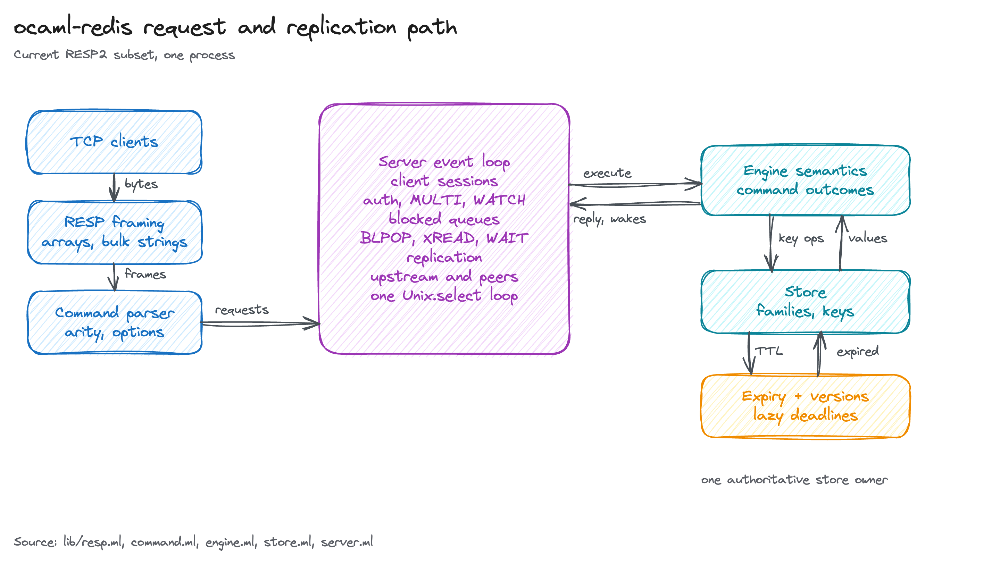

# ocaml-redis

A pedagogical, correctness-first Redis-compatible server in OCaml. It speaks the Redis serialization protocol
(RESP2) and keeps strings, lists, streams, sorted sets, geospatial values,
transactions, Pub/Sub, replication, and a small loader for Redis RDB files in
memory.

It illustrates a Redis implementation to see how the protocol, store, and event loop fit together.

## Architecture



The server is one process with one `Unix.select` loop. Bytes from TCP clients
pass through RESP framing and the command parser into that loop, which owns
client sessions, authentication, `MULTI`/`WATCH`, blocked queues, and
replication. Command outcomes run against a single authoritative store, and
expiry uses lazy deadlines instead of a background thread.

The figure is reproducible from
[`docs/figures/architecture.excalidraw`](docs/figures/architecture.excalidraw)
with
[`docs/figures/generate_architecture.py`](docs/figures/generate_architecture.py).

## Run

You need OCaml 5 and dune 3.22 or newer. Install the build tool and TLS
dependencies with opam:

```sh
opam install dune tls
```

Build and start the server:

```sh
dune build
dune exec app/server_main.exe -- --port 6382
```

In another terminal, with `redis-cli` installed:

```sh
redis-cli -p 6382 PING
PONG
redis-cli -p 6382 SET greeting hello
OK
redis-cli -p 6382 GET greeting
hello
```

## Test

```sh
dune test
```

The TLS test needs `openssl` on `PATH` because it generates a self-signed
certificate. The opt-in live lane compares replies with a local Redis:

```sh
OCAML_REDIS_LIVE=1 dune exec test/test_main.exe
```

## Limits

The server binds to loopback. `--requirepass` enables single-user
authentication, `--tls-cert` and `--tls-key` enable TLS for clients, and
`--maxclients` and `--max-output-buffer` bound runtime use. `--maxmemory`
rejects writes at the limit instead of evicting keys. Replication upstream
links are plaintext.

The compatibility matrix lists which commands match Redis. Known gaps and
operational limits are in the audit.

## Development shell

`devenv shell` provides OCaml, dune, ocamlformat, `redis-cli`, and `openssl`.
The shell scripts are `build`, `tests`, `fmt`, `fmt-check`, `server`, and
`live-test`.
